<p align="center"></p>

# PassBCH.cash

**Play a one-minute Bitcoin Cash game in your terminal while Claude Code is thinking. Every result is proven on-chain and anyone can verify it.** Every result is written to the BCH chain where anyone can recompute it. Five games: **Rock · Paper · Scissors** at a 3D TV-show table, **Up or Down** on the next minute of the BCH price, **Prompt Fight**, where your prompt trains an AI agent that fights another one live, **Coin Flip** (house seed committed first, plus your own seed) and **Typing Race** (type a phrase faster than the House Bot, or challenge a friend to a live race from the browser or a terminal; also in the terminal). The game server is trusted to hold balances (custodial, see the limits), but it cannot quietly change a result: the moves, prices and hashes are on chain and your browser re-checks them.

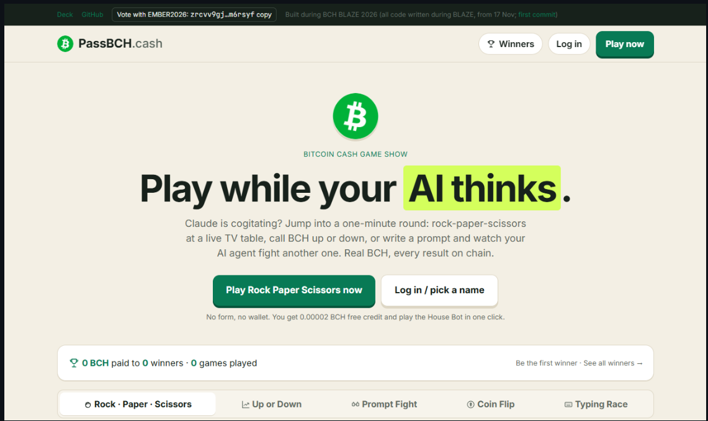

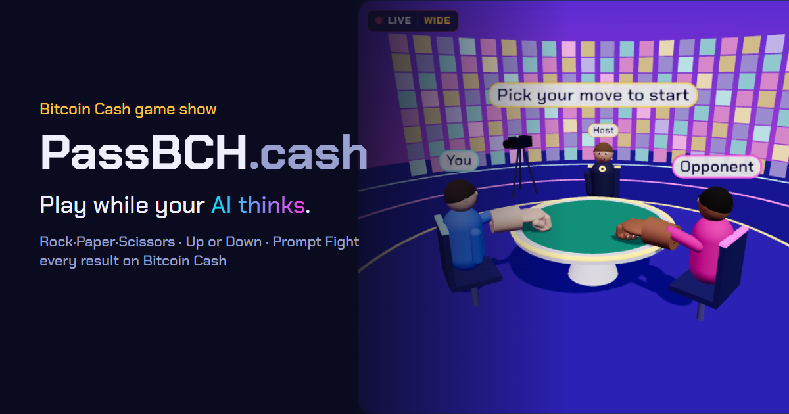

| | |
|---|---|
| Live app | https://passbch.vercel.app (same app: https://passbch-cash.vercel.app) |
| Play from any terminal | **`npx passbch`** (any OS with Node.js; friends join with `npx passbch race <code>`) · or Windows: `irm https://passbch.vercel.app \| iex` · Mac/Linux: `curl -sL passbch.vercel.app \| sh` |
| Verify any result | https://passbch.vercel.app/verify (paste a transaction id) |
| Worldwide winners | https://passbch.vercel.app/winners |
| Network | **Bitcoin Cash mainnet (live since 22 Nov 2026).** Built and tested on chipnet first; switch checklist: [docs/MAINNET.md](docs/MAINNET.md) |
| House wallet (writes every result) | Mainnet: [`bitcoincash:qqf029whcssjtkpfkyfk5s2z4t9vawvkfcn56u84un`](https://blockchair.com/bitcoin-cash/address/qqf029whcssjtkpfkyfk5s2z4t9vawvkfcn56u84un) · chipnet (testing): `bchtest:qql3cd7mlgqepacnudgh9qg6xc9na6a40qgmzdahgk` |
| First mainnet game | [`c1e08e25…3e14970`](https://blockchair.com/bitcoin-cash/transaction/c1e08e256ce37a8ec7a0b3f26b5fa02f81e8b90506053e9ea815845ff3e14970) · [verify it](https://passbch.vercel.app/verify/c1e08e256ce37a8ec7a0b3f26b5fa02f81e8b90506053e9ea815845ff3e14970) |
| Pitch deck | [Widget Factory deck (Google Slides)](https://docs.google.com/presentation/d/1ihRRCqbTXc56jZPF8c5AjsR113gBCRdJ/edit?usp=sharing) |
| Track | BCH BLAZE 2026, Mainnet Track |
| Who it is for | Developers waiting on AI agents, BCH newcomers (free starting credit, one-minute rounds), streamers and friends who want quick provable games |
| Tests | 62 automated (25 game rules · 11 Prompt Fight · 6 Coin Flip / Typing Race · 6 WizardConnect deposit · 5 on-chain record decoding · 6 Claude Code panel · 3 banner) · live chipnet end-to-end script (13 checks) · live browser audit of every page: all passing |

**What you can do:** get free starting credit with just a name · play RPS against the House Bot or send a friend a link · call BCH up or down for exactly one minute · write a strategy prompt and watch your AI agent fight · accept open challenges · add BCH with **WizardConnect** or a QR code (live quotes for other crypto and for INR/JPY/USD cards and UPI) · withdraw BCH · see every winner worldwide · open any player's history · **verify any result in your browser** · do all of it from a terminal with one short command · see the live round in Claude Code's status bar while Claude is thinking.

## Quick start (30 seconds)

```bash
npx passbch                  # play in any terminal (Node.js 18+), nothing to install or remember
npx passbch race <code>      # join a friend's Typing Race from the one line they send you
npx passbch join <code>      # join a friend's Rock · Paper · Scissors duel
npx passbch fight <code>     # join a friend's Prompt Fight
```

No Node.js? Windows: `irm https://passbch.vercel.app | iex` · Mac/Linux: `curl -sL passbch.vercel.app | sh` · or play in the browser at https://passbch.vercel.app.

The npm package ([packages/cli](packages/cli)) is a 30-line launcher: it always downloads the latest client from the live site, so it never goes stale.

## Judges: verify it in under 2 minutes

1. In any terminal: `npx passbch` (or open https://passbch.vercel.app).
2. Press `g`: a guest account with free starting credit, no form.
3. Press `4` and play one Coin Flip (or any game). The result ends with **Verified on Bitcoin Cash ✓** and a transaction id.
4. Press `v` and paste that id: the client decodes the on-chain record and recomputes the result itself. The website does the same at `/verify/<txid>`.

To see the friend flow, choose Typing Race → challenge a friend, and run the printed `npx passbch race <code>` in a second terminal.

## Bounty and prize tracks

| Track | Status |
|---|---|
| **Main BLAZE prizes** (1st / 2nd / 3rd, $8,000 in ParyonUSD) | Entered. Live demo, [Widget Factory deck](https://docs.google.com/presentation/d/1ihRRCqbTXc56jZPF8c5AjsR113gBCRdJ/edit?usp=sharing), banner (deck, GitHub, EMBER2026), WizardConnect deposits, mainnet switch ready ([docs/MAINNET.md](docs/MAINNET.md)). |
| **Build with XO / Migrate to XO** (General Protocols) | **Built.** [`xo/`](xo): the PassBCH Rock · Paper · Scissors game migrated into a trustless XO template (both stakes in an on-chain pot, commit-reveal checked and the winner paid by the script, timeout to the challenger). Executed on chipnet with invitations ([open](https://chipnet.imaginary.cash/tx/231206c80404e290355b94156f62f0787eaa4fafa3c731b79412a06b0b882465), [reveal follow-up](https://chipnet.imaginary.cash/tx/395fc025204be573e8efe4694134bee85a8a632680806515f914eb3535f7c3e1)); inspected as SUCCESS in the XO debug tool. Personal feedback: [xo/FEEDBACK.md](xo/FEEDBACK.md). |
| Stablecoin Bridge, Decentralized Identity, SolidCash, FoldingCash claims | Not entered (different products). |

## Mainnet transactions

PassBCH.cash runs on **Bitcoin Cash mainnet** at https://passbch.vercel.app. Real transactions:

| What | Transaction |
|---|---|
| House wallet funded (0.01520254 BCH) | [`8215f5fb…f3a3eabb`](https://blockchair.com/bitcoin-cash/transaction/8215f5fb8adeea2a3fcb66ef4912c1ae413339411617b16845772ed2f3a3eabb) |
| **First real mainnet game:** new player Judge572, Coin Flip, 500 sats from the free bonus, picked heads, landed tails. The `SQG1` record (house seed commitment, both seeds, result) is in the `OP_RETURN` output | [`c1e08e256ce37a8ec7a0b3f26b5fa02f81e8b90506053e9ea815845ff3e14970`](https://blockchair.com/bitcoin-cash/transaction/c1e08e256ce37a8ec7a0b3f26b5fa02f81e8b90506053e9ea815845ff3e14970) · [Verify ✓](https://passbch.vercel.app/verify/c1e08e256ce37a8ec7a0b3f26b5fa02f81e8b90506053e9ea815845ff3e14970) |

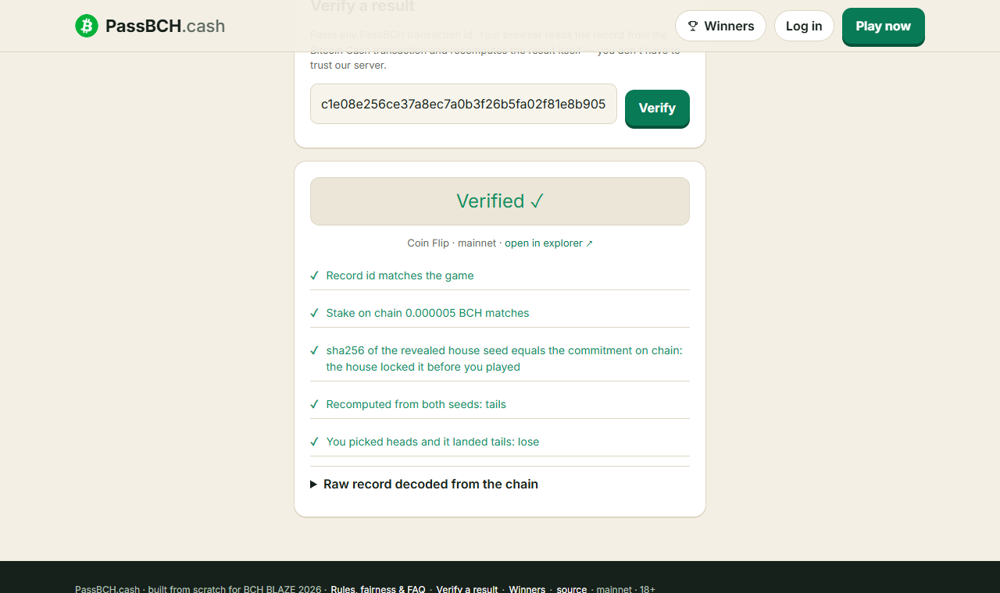

## Evaluator Notes

**Problem.** Online games ask you to trust the house: you can't see whether the opponent saw your move, whether the price was picked after the fact, or whether a result was edited. And developers spend minutes every day watching an AI agent think.

**On Bitcoin Cash (chipnet), verifiable now:**

- Every finished game is an `OP_RETURN` record sent by the house wallet: `SDL1` (duel: both moves, the creator's commitment, the result), `SUD1` (Up/Down: side, entry and exit price, result), `SPF1` (Prompt Fight: target, step, winner, SHA-256 of every move). Layouts: [server/engine.mjs](server/engine.mjs), [server/promptfight.mjs](server/promptfight.mjs).
- The **Verify** page fetches the raw transaction, decodes the record **in your browser** and recomputes the result: `sha256(move:salt) == commitment`, who beats whom, price direction, or the full Race-to-N replay. The server's copy is only compared, never trusted ([web/src/duel/Proof.jsx](web/src/duel/Proof.jsx)).
- Deposits arrive on chain at a per-player address; withdrawals are real chipnet transactions.

**Trusted, off-chain (stated plainly):** balances live in a Postgres database run by the platform (custodial, like a card room). The server runs the House Bot, fetches prices and calls the AI model. It could refuse to pay or stop recording, but it cannot change a recorded result without the mismatch showing on the Verify page. There is one house key.

**Track fit:** useful BCH transactions a judge can make from the app (deposit by WizardConnect or QR, withdraw, plus on-chain result records), a live demo from one link, and a top-of-page BLAZE banner on the home page.

**Verify in 5 minutes:**

1. `npm ci && npm test` (no secrets or accounts needed) → **62 tests pass**.
2. Open https://passbch.vercel.app/verify/7a7fad7ffad96b2c73f640628e77c0b9de10216d5a15dcc9f5f15cb5f17d1bce → a real Prompt Fight shows **Verified ✓** with 5 checks recomputed in your browser.
3. Open https://passbch.vercel.app → pick a name → **Rock · Paper · Scissors** → play the House Bot → watch the table, then press **Verify ✓** on your own result.
4. In a terminal: `curl -sL passbch.vercel.app | sh` (or the PowerShell line) → the same account and games.

**History.** The repository started on 17 Nov 2026 with an earlier BLAZE idea in this same repo (PassRate.cash, AI coding exams sealed on chain). It was pivoted on 21 Nov 2026 to PassBCH.cash. All code was written during BLAZE (first commit [2938834](https://github.com/Lakshmikanth-3/PassBCH.cash/commit/29388349185c1e553e30cd6fca99d296a25c6bd7), 17 Nov 2026). The PassRate code is in the git history; the AI exam harness remains in `ai/` but is not used by the site.

## Contents

- **Overview:** [Evaluator Notes](#evaluator-notes) · [The idea in 3D](#the-idea-in-3d) · [The problem](#the-problem) · [Why Bitcoin Cash](#why-bitcoin-cash) · [Executive summary](#executive-summary-for-technical-evaluators)
- **How it works:** [The three games](#the-three-games) · [System architecture](#system-architecture) · [Commit-reveal (RPS)](#commit-reveal-rock--paper--scissors) · [One-minute price call](#up-or-down-exactly-one-minute) · [Prompt Fight](#prompt-fight-race-to-n) · [On-chain records](#on-chain-records) · [On-chain vs off-chain](#on-chain-vs-off-chain)
- **Proof and evaluation:** [Evidence](#evidence-real-transactions-on-bch-chipnet) · [Judge's quick evaluation guide](#judges-quick-evaluation-guide) · [Use it](#use-it-about-3-minutes)
- **Security:** [Guarantees and limits](#what-is-guaranteed-and-the-limits) · [Threat model](#threat-model-and-security-boundaries) · [Abuse controls](#money-rules-and-abuse-controls)
- **Quality:** [Tests](#tests) · [Feature-to-test traceability](#feature-to-test-traceability)
- **Developers:** [Run locally](#run-locally) · [Deploy your own](#deploy-your-own) · [Repository structure](#repository-structure) · [Libraries](#libraries) · [Status](#status) · [AI assistance](#ai-assistance-and-licence)

## The idea in 3D

Each game is a small TV studio built in three.js. Nothing plays on its own: the stage only performs **your real result**, and a director cuts between named camera shots (`● LIVE | CAM YOU`) like a live broadcast.

| | |
|---|---|
| 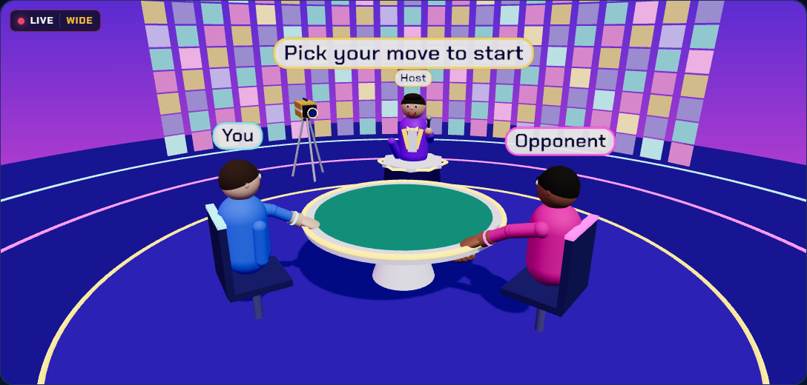 | 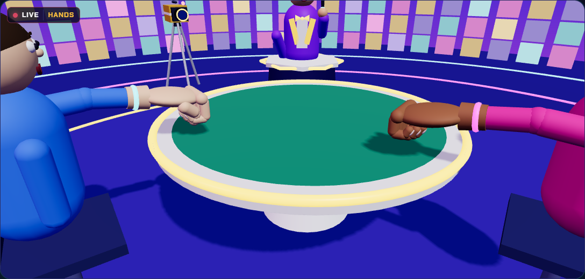 |
| **Rock · Paper · Scissors.** You, your opponent and a game-show host at a table; TV cameras on tripods aim at it. | **The shake.** Jointed hands (3 joints per finger) shake "Rock… Paper… Scissors…", reveal the real moves, and the winner gets a spotlight and confetti. |
| 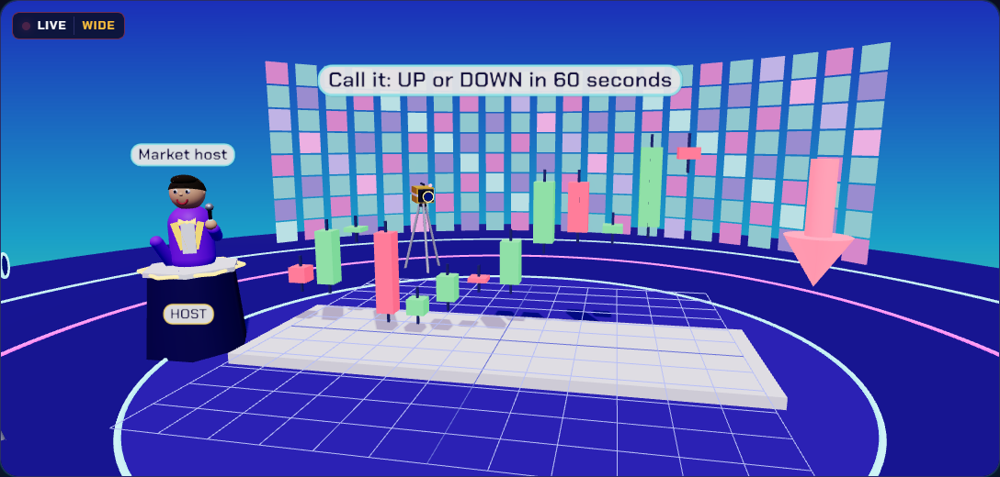 | 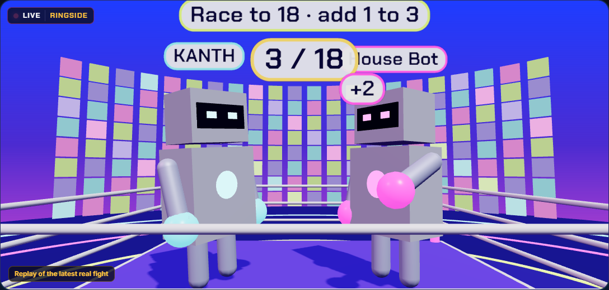 |
| **Up or Down.** The last 12 real one-minute BCH candles, a glowing arrow and a market host who cheers when your call wins. | **Prompt Fight.** Two robot agents in a ring; every move is a punch and the counter climbs to N. The landing page replays the latest real fight. |

## The problem

| Pain | What goes wrong today |
|---|---|
| "Provably fair" games | Results come from a server you can't inspect; you can't recompute a past round. |
| Peer-to-peer games | Whoever moves second could see the first move; one side can quit when losing. |
| Price-prediction games | The settlement price or time can be picked after the bets; tie rules are vague. |
| AI waiting time | Developers watch "Cogitating…" many times a day with nothing to do. |

## Why Bitcoin Cash

| BCH property | What it does here |
|---|---|
| Fees below a cent | Every single game result is its own transaction (≈ 300 sats on chipnet), so the whole history is public |
| `OP_RETURN` data | Compact records (38–59 bytes) hold moves, prices and hashes that anyone can decode |
| Fast, simple payments | One-minute games with BCH deposits and withdrawals |
| WizardConnect | Players connect a BCH wallet (e.g. Paytaca) and approve one deposit, without sharing keys |

## Executive Summary for Technical Evaluators

PassBCH.cash is a custodial BCH game platform with **verifiable results**: each game's decisive data is written to Bitcoin Cash and recomputed by the player's browser or terminal.

| Concern | How PassBCH.cash handles it | Where in the code |
|---|---|---|
| Opponent seeing your move | You send only `sha256(move:salt)`; the salt stays on your device until you reveal. A reveal must match the commitment. | [server/engine.mjs](server/engine.mjs) `commitMove`, `checkReveal` |
| Quitting when losing | No reveal within 2 minutes = forfeit to the opponent | `duelStatus`, `sweep()` in [server/service.mjs](server/service.mjs) |
| House Bot cheating | Its move is fixed per duel by a secret seed before you reveal | `botMove` |
| Price picked after the bet | Entry = public trade at the second you bet; exit = public trade exactly 60 s later | [server/price.mjs](server/price.mjs) `priceAt` |
| AI judge manipulation | Prompt Fight has no judge: code enforces Race-to-N; each agent sees only its own prompt | [server/promptfight.mjs](server/promptfight.mjs) |
| Edited results | Every result is an `OP_RETURN` record; the Verify page recomputes it from the raw transaction | [web/src/duel/Proof.jsx](web/src/duel/Proof.jsx) |
| Double payout on a slow broadcast | The txid is saved before broadcasting; a timed-out withdrawal is never refunded | `houseSend` in [server/chain.mjs](server/chain.mjs) |
| Bonus farming with two accounts | Won bonus stays bonus; bonus must be played 2× before withdrawing; 3 bonuses per network | `settle`, `withdrawAllowed` |

**Main limitation, stated plainly.** PassBCH.cash is **not trustless**. Balances are held by the platform, and the server runs the bot and price feed. A dishonest operator could refuse withdrawals or stop recording; it cannot rewrite a recorded result without the Verify page showing a mismatch. See [Threat Model](#threat-model-and-security-boundaries).

## The five games

| Game | You do | Settled by | Pays |
|---|---|---|---|
| **Rock · Paper · Scissors** | Pick a move and stake; play the House Bot, send a friend a link, or accept an open challenge | Commit-reveal; no reveal in 2 min = forfeit | Winner takes the pot; draw = stakes back |
| **Up or Down** | Tap ▲ UP or ▼ DOWN and confirm | Coinbase BCH-USD last trade at entry and exactly 60 s later | 1.9× (same price = stake back) |
| **Prompt Fight** | Write a strategy prompt (≤ 400 chars); fight the House Agent or a friend | Code-enforced Race to N; Groq `gpt-oss-20b` plays each side | Winner takes the pot |

Stakes: 0.000025 · 0.00005 · 0.0001 · 0.00025 BCH. A fourth card, **Upcoming BCH games**, marks what's next.

| **Coin Flip** | Pick heads or tails | The house commits `sha256(seed)` first, your terminal or browser adds its own seed, result = parity of `sha256(seed:yourSeed:id)` | 1.9× |
| **Typing Race** | Type a phrase faster than the House Bot (45–80 wpm, fixed by a committed seed), or race a friend live on the same phrase | Server-measured time; paste blocked; superhuman speed loses | 1.9× vs the bot · winner takes the pot vs a friend |

**Friends, terminal to terminal.** Every friend game prints one short line, for example `npx passbch race 6f3c…`. Your friend types it on any computer, in any terminal, and you play head to head. The same link also opens in a browser.

## System Architecture

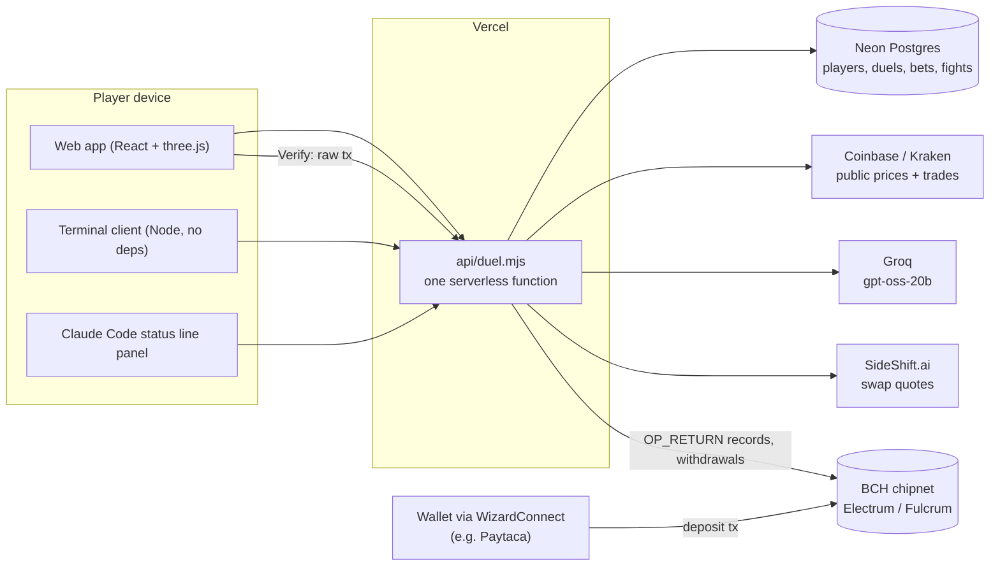

| Component | Responsibility | Source |
|---|---|---|
| Game rules | RPS outcome, commitments, stakes, settlement buckets, fees, Up/Down timing, record layouts | [server/engine.mjs](server/engine.mjs) |
| Prompt Fight | Setup draw, prompts, legal moves, match loop, Groq calls, `SPF1` record | [server/promptfight.mjs](server/promptfight.mjs) |
| Game service | Players, duels, bets, fights, withdrawals, winners, profiles, activity, in SQL transactions with row locks | [server/service.mjs](server/service.mjs), [server/db.mjs](server/db.mjs) |
| House wallet | Builds, signs and sends `OP_RETURN` records and withdrawals; per-player deposit addresses | [server/chain.mjs](server/chain.mjs) |
| Prices | Price at an exact second, one-minute candles, FX (one source: BCH-USD × USD FX), SideShift quotes | [server/price.mjs](server/price.mjs) |
| API | All routes, recording claims, timeouts | [api/duel.mjs](api/duel.mjs) |
| Web app | Pages, 3D stages, vault, verify, winners, profiles | [web/src/](web/src/) |
| Terminal client | Full parity with the web app; self-updates | [web/public/duel.mjs](web/public/duel.mjs) |
| Claude Code panel | Status line + hooks that show the live round while Claude thinks | [panel/panel.mjs](panel/panel.mjs) |

## Commit-reveal (Rock · Paper · Scissors)

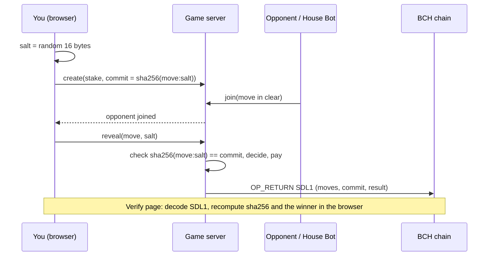

A creator who doesn't reveal within 2 minutes forfeits. From 21 Nov 2026 the reveal salt is stored, so new duels pass the full commitment check; earlier duels show an information note instead.

## Up or Down: exactly one minute

1. You tap ▲ or ▼ and confirm. The server reads the **last Coinbase BCH-USD trade at that second** (Kraken as fallback) and stores it as your entry.
2. Exactly 60 seconds later the last trade at that second is the exit. The UI shows a countdown ring, a price line with your entry, and *winning / level / losing* live.
3. Higher means UP wins, lower means DOWN wins, and **the same price returns your stake**. A win pays 1.9×; the 0.1 is the house edge.
4. The `SUD1` record stores side, entry, exit and result, and anyone can recompute the direction.

## Prompt Fight: Race to N

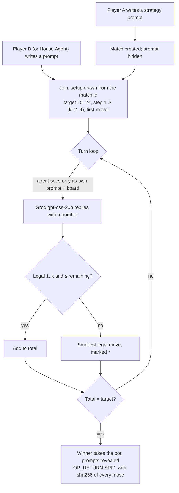

There is no AI judge to talk into a decision: the code enforces the rules, and one agent cannot read or attack the other's prompt. A real match takes about 6–20 seconds and is replayed on the 3D ring.

## On-chain records

| Record | Size | Layout (little-endian) |
|---|---|---|
| `SDL1` duel | 59 B | `SDL1` · duel id (16) · result (1) · stake (4) · creator move (1) · joiner move (1) · commitment (32) |
| `SUD1` Up/Down | 38 B | `SUD1` · bet id (16) · side (1) · result (1) · stake (4) · entry time (4) · entry price ×10⁴ (4) · exit price ×10⁴ (4) |
| `SQG1` Coin Flip / Typing Race | 66 B | `SQG1` · game id (16) · kind (1) · outcome (1) · stake (4) · a (4) · b (4) · house-seed commitment (32). Coin: a = your pick, b = the flip. Typing: a = your time (ms), b = the bot's time (ms) |
| `SPF1` Prompt Fight | 59 B | `SPF1` · match id (16) · winner (1) · target (1) · max step (1) · stake (4) · sha256 of all moves (32) |

Recording never blocks a game. Each settled row is **claimed atomically** before sending (no lock that can stay held), and a failed broadcast clears its txid so it is retried.

## On-chain vs off-chain

| Data | Where | Why |
|---|---|---|
| Moves, commitments, prices, winners, move hashes | BCH `OP_RETURN` (house wallet) | Public, permanent, recomputable |
| Deposits and withdrawals | BCH transactions | Real money movement |
| Balances, bonus, wagering, player names | Neon Postgres | Custodial ledger |
| Prompts | Postgres; revealed after the fight | Hidden during the lobby |
| RPS salt | Your browser until reveal, then Postgres | Needed to re-check the commitment |
| Login code | Your browser / terminal config | Account key (see limits) |

## Evidence: real transactions on BCH chipnet (testing before mainnet)

Every row is a real transaction. Click to open it in the chipnet explorer, or paste the id into [Verify](https://passbch.vercel.app/verify).

| What happened | Players | Result | Transaction |
|---|---|---|---|
| Duel: rock vs paper (salt published, full commit check) | NARAYANAN vs House Bot | House Bot wins | [aabd0d33…4e19e4dd](https://chipnet.imaginary.cash/tx/aabd0d3307cab5bb20bf9e243f954e2734a1393dd8489417aca0d5eb4e19e4dd) |
| Duel: paper vs paper | NARAYANAN vs House Bot | Draw, stakes back | [d5913d18…1722357e](https://chipnet.imaginary.cash/tx/d5913d189c0f2634b83672512909a5419cde3f0353b86175e57e091e1722357e) |
| Up/Down: UP from $198.53 → $198.59 | SAM | Win, 1.9× | [e6ba1ddd…5c23670d](https://chipnet.imaginary.cash/tx/e6ba1ddd9fe346fe0f86eff6366aef66334bec0a91688c9373e20eef5c23670d) |
| Up/Down: DOWN from $198.66 → $198.80 | NARAYANAN | Lose | [0f2f18da…7617ab55](https://chipnet.imaginary.cash/tx/0f2f18da37cbf56168d0dfa837a7be74f5795b065a7bf3f40e15aa277617ab55) |
| Prompt Fight: Race to 18, step 1–3 | KANTH vs House Agent | KANTH wins | [7a7fad7f…5f17d1bce](https://chipnet.imaginary.cash/tx/7a7fad7ffad96b2c73f640628e77c0b9de10216d5a15dcc9f5f15cb5f17d1bce) |
| Withdrawal: 5,000 sats → 4,600 sent after the fee (end-to-end script) | test player | Confirmed | [c5a7bb4b…fb5fb0ee](https://chipnet.imaginary.cash/tx/c5a7bb4bee94602b575a288ee73ddc71a004e18df3186ebfdd27b7ecfb5fb0ee) |
| House wallet funded | operator | 200,000 sats | [a9475687…6bd92211](https://chipnet.imaginary.cash/tx/a947568787d4b78350d2e6e096b311c3ad4ef91ebe2d74fef415c7306bd92211) |

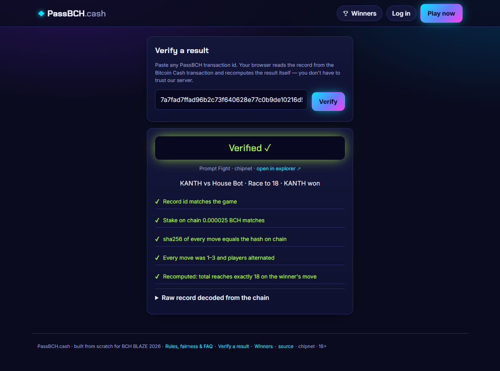

## Judge's Quick Evaluation Guide

Everything runs on **BCH chipnet**; no mainnet funds are involved.

- **Live app:** https://passbch.vercel.app
- **Repository:** https://github.com/Lakshmikanth-3/PassBCH.cash
- **Verify:** https://passbch.vercel.app/verify
- **Winners worldwide:** https://passbch.vercel.app/winners
- **Rules, fairness and FAQ:** https://passbch.vercel.app/rules
- **House wallet:** [explorer](https://chipnet.imaginary.cash/address/bchtest:qql3cd7mlgqepacnudgh9qg6xc9na6a40qgmzdahgk)

1. **Play a duel.** Open the app → *Play free* → a name → *Rock · Paper · Scissors* → pick a move → *Play the House Bot*. Watch the table; the card reveals the result after the show.
2. **Check it.** Press *Verify ✓* under the result. You should see "Verified ✓" with the commitment, the recomputed winner and the on-chain result.
3. **Call the price.** *Up or Down* → ▲ UP → *Confirm*. Exactly 60 s later the studio shows the result and your bet links to its record.
4. **Fight with a prompt.** *Prompt Fight* → *Strategy 1* → *Fight the House Agent*. Watch the replay; both prompts are revealed afterwards.
5. **Terminal.** `irm https://passbch.vercel.app | iex` (Windows) or `curl -sL passbch.vercel.app | sh`. Use `[v]` to verify, `[l]` for winners worldwide and `[w]` for the vault.

Free credit: 0.00025 BCH per new player (up to 3 per network, 100 in total).

## Use it (about 3 minutes)

| Do this | You see |
|---|---|
| Home → the 3D showcase tabs | RPS table, Up/Down studio, and a replay of the latest real Prompt Fight |
| *Play free* → name (or *Log in* with a login code) | 0.00025 BCH bonus; four game cards |
| RPS → move → stake → *Play the House Bot* | Host counts "Rock… Paper… Scissors…", hands reveal, winner spotlight; result card + *Verify ✓* |
| RPS → *Challenge a friend* → share `/duel/<id>` | Your friend opens the link, picks a move; the table replays with both names |
| Up or Down → ▲ / ▼ → *Confirm* | 60 s ring, live *winning / losing*, studio celebration on a win |
| Prompt Fight → write a prompt → *Fight the House Agent* | Counter climbs to N in the ring; turns and both prompts shown after |
| Vault → *Add funds* | BCH via **WizardConnect** or QR (works now); other crypto and bank/card/UPI with live quotes (mainnet) |
| Vault → History → *Export CSV* | Every game, deposit, withdrawal and bonus |
| Winners → a player's name | Profile: net, win rate, games on chain, *Verify ✓* per game |
| Claude Code: `node panel/panel.mjs install` + `node panel/panel.mjs feed` | Status line shows the live round, and "Claude thinking 0:42 · play now →" while Claude works |

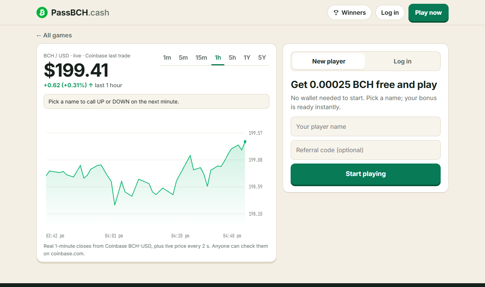

## What is guaranteed, and the limits

| Enforced | By |
|---|---|
| Your RPS move can't be seen or changed after you commit | SHA-256 commitment; reveal must match |
| Quitting doesn't help | 2-minute reveal deadline → forfeit |
| Up/Down uses the price at the exact second, not a later one | Public trade history (Coinbase, Kraken fallback) |
| Prompt Fight can't be argued or prompt-injected into a win | Code-enforced rules; agents see only their own prompt |
| Every finished game has a public record | `OP_RETURN` from the house wallet |
| A changed result is visible | Verify recomputes from the raw transaction |
| Withdrawals can't be paid twice | txid saved before broadcast; no refund after a timed-out send |

| Limit | Detail |
|---|---|
| Custodial | Balances are held by the platform. A dishonest operator could refuse withdrawals. |
| House Bot seed | Fixed before you reveal, but the per-duel seed isn't published yet, so you can't independently audit the bot's choice. |
| Price source | Coinbase last trade (Kraken fallback). An exchange glitch would affect a round. |
| AI provider | Groq free tier allows roughly 1–2 fights a minute site-wide; under load some moves become automatic (marked `*`). |
| Login code | The code is the account key; losing it loses the account. No wallet-signature login yet. |
| Other crypto / fiat | Quotes are live; swaps (SideShift) and bank/card/UPI (licensed partner) switch on only with mainnet. |
| Network | Chipnet only. Test BCH has no value; local-currency figures say "at mainnet value". |
| Regulation | Real-money games are regulated in many countries (including India). Get legal advice before mainnet. 18+. |

## Threat Model and Security Boundaries

**Assets:** player balances, moves before reveal, prompts before a fight, the house key, the integrity of results.

**Threat actors:** an opponent trying to see or change a move; a player quitting when losing; one person with many accounts (bonus farming); someone editing results in the database; network failures during a payout.

| Guarantee | Provided by | Notes |
|---|---|---|
| Moves stay hidden until reveal | Browser commitment | The House Bot plays after your commitment |
| Results can't be silently edited | `OP_RETURN` + browser Verify | Not retroactive for rows recorded before the salt was stored (shown as information) |
| Bonus can't be laundered by self-duels | Same-bucket settlement + 2× wagering + 3 per network | VPNs could get round the network limit |
| Withdrawals are idempotent | Txid stored before broadcast | A slow broadcast is reported, not refunded |
| House-wallet sends never collide | One send at a time (transaction-scoped database lock) | Added after a withdrawal raced a result record and never confirmed |
| Recording can't deadlock | Atomic row claims with 30 s retry | Replaced an earlier advisory lock that could stay held |
| Balances are honest | **Trusted operator** | Not enforced by the chain |

## How Bitcoin Cash and the platform earn

| Who | How |
|---|---|
| **The Bitcoin Cash network** | Every finished game is its own on-chain transaction (an `OP_RETURN` record of about 300 sats in fees), plus real deposits and withdrawals. That is everyday, small-value BCH use: miners collect the fees. |
| **The platform** | A 5% fee on every withdrawal, and a small house edge on Up or Down (a right call pays 1.9×). Rock · Paper · Scissors, Prompt Fight and friend races have no house edge. |
| **Players** | The pot. Friend games are player vs player; the platform only takes its fee when you withdraw. |

Future revenue: sponsored AI-model tournaments and integrations with developer tools (status-line panels for AI coding agents).

## Money rules and abuse controls

| Rule | Value |
|---|---|
| Free credit | 0.00025 BCH; with a referral code the new player gets 0.0005 and the inviter 0.00025 |
| Bonus limits | 100 grants platform-wide, 3 per network address |
| Bonus use | Play only; won bonus in friend duels stays bonus; play 2× your bonus before any withdrawal |
| Withdrawal | Minimum 0.0001 BCH; 5% platform fee (at least 0.000004 BCH) |
| House edge | Up/Down pays 1.9× (5%); RPS vs the bot and Prompt Fight have no edge |

## Tests

| Suite | Command | Result | Covers |
|---|---|---|---|
| Game rules | `npm test` (server/test/engine.test.mjs) | 25 passed | All 9 RPS outcomes; commit/reveal incl. short salts; bot move uniformity; stake buckets; settlement conservation; anti-abuse (self-duels produce no cash, House Bot pays cash, 2× wagering); withdrawal fee; signup/referral caps; names; duel lifecycle; `SDL1`/`SUD1` round trips; one-minute Up/Down timing; Up/Down payouts |
| Prompt Fight | `npm test` (server/test/promptfight.test.mjs) | 8 passed | Setup ranges; legal moves; parsing; prompt limits; **each agent sees only its own prompt**; a strategic prompt beats a lazy one (fake model); a broken model still finishes; `SPF1` size |
| WizardConnect deposit | `npm test` (web/test/wizard.test.js) | 6 passed | Addresses from xpub keys; unsigned deposit tx; change path; input paths; short-wallet refusal; JSON wire format |
| Record decoding | `npm test` (web/test/proof.test.js) | 5 passed | The browser decoder reads exactly what the server writes, for all three record types |
| Claude Code panel | `npm test` (panel/panel.test.mjs) | 6 passed | Status line for betting / coding / results; "Claude thinking" line; stale feed |
| Banner | `npm test` (web/test/banner.test.jsx) | 3 passed | BLAZE eligibility links, deck link, network pill |
| Live end to end | `BASE=https://passbch.vercel.app npm run e2e` | 13 / 13 | Signup, referral, bot duel, friend duel, self-join refused, changed move refused, payout, leaderboard, on-chain record, deposit address, bonus not withdrawable, withdrawal with fee |
| Live browser audit | Edge (headless) over every page, signed out, signed in and phone width | No app errors | Landing, login, games, all three game pages, vault, add funds, withdraw, winners, rules, verify, profile, 404, bad links |

The live suites spend a little chipnet BCH from the house wallet.

## Feature-to-Test Traceability

Re-run for this update on 21 Nov 2026: `npm test` → **62 passed**.

| Feature | Source | Test | What it proves | What it does not prove |
|---|---|---|---|---|
| Commit-reveal | server/engine.mjs | engine.test.mjs | A commitment opens only with the same move and salt; short salts rejected | That the browser's random salt is never leaked |
| Settlement & anti-abuse | server/engine.mjs, service.mjs | engine.test.mjs + e2e | Money is conserved; self-duels with bonus give no cash; bonus not withdrawable | Collusion between real people |
| One-minute Up/Down | server/engine.mjs, price.mjs | engine.test.mjs + manual live rounds | Timing, payouts, tie refunds, record round trip | The exchange's own trade data |
| Prompt Fight fairness | server/promptfight.mjs | promptfight.test.mjs | Rule enforcement; prompt isolation; always finishes | Model quality under Groq rate limits |
| Verify | web/src/duel/Proof.jsx | proof.test.js + live check | Decoder matches the server's bytes; real records verify | Records written before salts were stored |
| WizardConnect deposit | web/src/duel/wizard.js | wizard.test.js | Correct unsigned tx and input paths | Every wallet's WizardConnect behaviour (Paytaca phone test pending) |
| Withdrawals | server/chain.mjs, api/duel.mjs | e2e (live) | Real chipnet payout with fee | Mainnet |
| Pages | web/src | live browser audit | No app errors across every page and phone width | Every browser and device |

## Limits to know before you play

- **Custodial:** balances are held by the platform (a trusted operator); results are provable, balances are not.
- **18+ only.** Real-money games are regulated in many countries; check your local law before playing on mainnet.
- **Free-play mode:** on chipnet the BCH has no value. On mainnet the free bonus is 0.00002 BCH (50 grants platform-wide, 3 per network address, 2× wagering before withdrawal).
- **Race to N is a solved game:** the first mover can have a forced win, so the first move is a commit-reveal coin flip (the seed hash is published before the fight, the seed after).
- **House solvency** is shown live on /winners and /rules: house wallet balance (from chain) against what players could withdraw.

## Demo video

`docs/demo/passbch-demo-mainnet.mp4` (about 4 minutes, voice-over, no music; the link is also on the DoraHacks page):

- **0:00** the problem: Claude Code is "Cogitating…" for minutes while the developer idles; then `npx passbch` in the same terminal.
- **0:24** how Bitcoin Cash earns: one game = one on-chain transaction, network fees to miners, a 5% platform fee on withdrawals.
- **0:35** a real terminal session (recorded on chipnet): all five games, a friend joining from a second terminal with `npx passbch race <code>`, the leaderboard, Verify and a real withdrawal.
- **2:18** **live on mainnet:** a new player on https://passbch.vercel.app plays one real Coin Flip; the result is written to Bitcoin Cash mainnet and the Verify page recomputes it (Verified ✓ · mainnet); then the confirmed mainnet transaction.
- **end** how judges can verify it in under 2 minutes.

## Troubleshooting

- **The website does not open:** some mobile hotspots and ISPs fail to resolve or route `*.vercel.app` intermittently. Switch the DNS to 1.1.1.1 or 8.8.8.8, or try another network; the site itself is up.
- **`npx passbch` says "could not determine executable":** the npm release is still being processed; use `irm https://passbch.vercel.app | iex` (Windows) or `curl -sL passbch.vercel.app | sh` meanwhile.
- **"No free bonus this time":** the free credit is limited to 3 accounts per network address; add a little BCH from the vault instead.

## Run locally

Requires Node 22+.

```bash
npm ci
npm test                 # 62 tests, no secrets needed
npm run dev              # web app on http://localhost:5173 (talks to the live API through a proxy)
```

To run your own API you need a Postgres URL and a chipnet house key:

```bash
export DATABASE_URL=postgres://…  HOUSE_SK=<64 hex>  HOUSE_SECRET=<random>  GROQ_KEY=<groq key>
npm run api              # http://localhost:8787
BASE=http://localhost:8787 npm run e2e
```

## Deploy your own

1. Create a Vercel project from this repo; `vercel.json` builds `web/` and serves `api/duel.mjs`.
2. Add a Neon Postgres store (Vercel Marketplace), and the environment variables `HOUSE_SK`, `HOUSE_SECRET` and `GROQ_KEY`.
3. Fund the house address (shown by `node -e "import('./server/chain.mjs').then(c=>console.log(c.houseKey().address))"`) with chipnet BCH from a faucet.
4. Mainnet only after full testing: [docs/MAINNET.md](docs/MAINNET.md).

## Repository structure

```
api/duel.mjs                All HTTP routes (one Vercel function) + terminal invite launcher
server/engine.mjs           Game rules, commitments, settlement, fees, record layouts (SDL1, SUD1, SQG1)
server/promptfight.mjs      Prompt Fight rules, Groq calls, SPF1 record
server/service.mjs          Postgres game service: duels, bets, fights, coin flips, races, winners, profiles
server/db.mjs               Schema (Neon Postgres)
server/chain.mjs            House wallet: OP_RETURN records, withdrawals, deposit addresses (chipnet or mainnet)
server/price.mjs            Price at a second, candles, FX, SideShift quotes
server/test/                Game-rule, Prompt Fight, Coin Flip and Typing Race tests
web/src/                    React app: pages, 3D stages (three/), games, vault, verify, winners, banner
web/public/duel.mjs         Terminal client (+ play.ps1 / play.sh launchers)
web/test/                   Browser-side tests (record decoder, WizardConnect, banner)
packages/cli/               npm package `passbch` (npx passbch): downloads and runs the latest terminal client
panel/                      Claude Code status line + hooks
xo/                         XO bounty: trustless Rock Paper Scissors escrow template, chipnet runner, invitations, feedback
scripts/e2e.mjs             Live end-to-end check
docs/                       Report, mainnet checklist, deck text, Telegram post, images, demo video
ai/                         Earlier PassRate AI-exam harness (not used by the site)
```

## Libraries

React 18.3 · three.js 0.170 · Vite 5.4 · CashScript 0.11.5 (transaction builder, Electrum provider) · @bitauth/libauth 3.0 · WizardConnect (@wizardconnect/react 0.2.6, dapp 0.2.7, core 0.2.10) · pg 8.13 · qrcode 1.5 · Vitest 2.1 + Testing Library · Groq API (`openai/gpt-oss-20b`) · Coinbase, Kraken and SideShift public APIs.

## Status

- **Live on Bitcoin Cash mainnet** at https://passbch.vercel.app since 22 Nov 2026 (first real game above). Five games, the vault, WizardConnect and QR deposits, withdrawals, winners, profiles, Verify, Rules, the terminal client and `npx passbch` all work on the hosted copy.
- Every feature was first tested on chipnet: 62 automated tests, the live end-to-end check (13/13) and a live browser audit pass.
- XO bounty built: [`xo/`](xo).
- **Not built yet:** swaps with other crypto and fiat on/off-ramps (quotes only), wallet-signature login, tournaments, notifications.

## AI assistance and licence

Built during BCH BLAZE 2026 (17–22 Nov 2026). Most code was written with an AI coding assistant (Claude Code) under the author's direction; the author chose the product, the games, the trust model and every deployment. Not legal or gambling advice; 18+.
