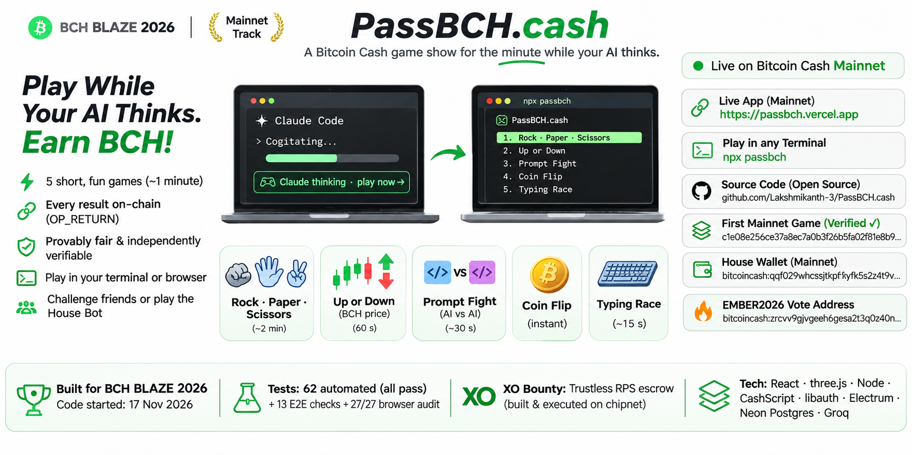
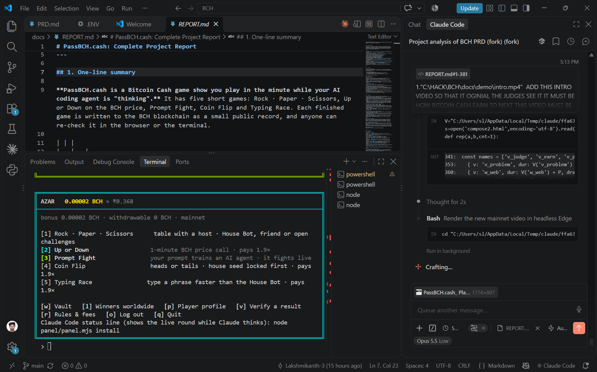
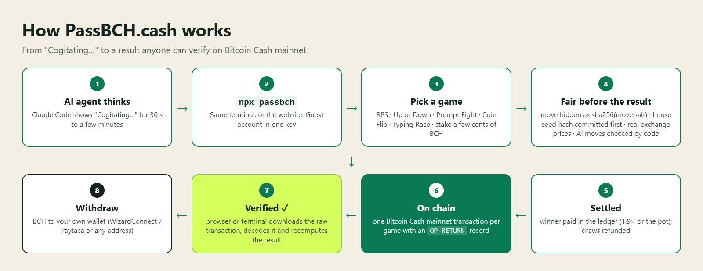
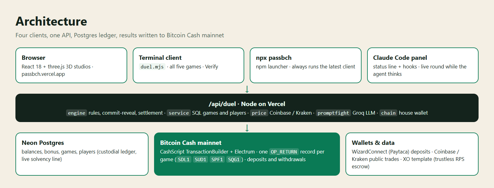

# PassBCH.cash: play while your AI thinks

**A Bitcoin Cash game show for the minute your AI coding agent is thinking. Live on mainnet. Every result is on chain, and anyone can recompute it.**

| | |
|---|---|
| Live app (mainnet) | https://passbch.vercel.app |
| Play in any terminal | `npx passbch` |
| Source code | https://github.com/Lakshmikanth-3/PassBCH.cash |
| First mainnet game | [`c1e08e25…3e14970`](https://passbch.vercel.app/verify/c1e08e256ce37a8ec7a0b3f26b5fa02f81e8b90506053e9ea815845ff3e14970): open it and see **Verified ✓** |
| Pitch deck | https://docs.google.com/presentation/d/1ihRRCqbTXc56jZPF8c5AjsR113gBCRdJ/edit?usp=sharing |
| Demo video | https://youtu.be/Or1W7viUzTI |

---

## Demo video (2:50, every game on mainnet)

https://youtu.be/Or1W7viUzTI

## Why this matters

Millions of developers now wait on AI agents. Claude Code shows "Cogitating…" for 30 seconds to a few minutes, many times a day. That is **dead time, every day, for every developer**. Our audience is already sitting in a terminal and already bored.

Online "provably fair" games have their own problem: you still have to trust the operator, because you can't check the result yourself.

**PassBCH.cash fixes both.** You get a one-minute game in the same terminal, paid in Bitcoin Cash, and a result the chain proves.

## What you can play

| Game | Length | What makes it fair |
|---|---|---|
| **Rock · Paper · Scissors** | ~1 min | Commit-reveal: only `sha256(move:salt)` is sent until both players commit |
| **Up or Down** | exactly 60 s | Entry and exit are real Coinbase BCH-USD trades at the exact second |
| **Prompt Fight** | ~30 s | Your prompt trains an AI agent; code enforces the rules, no AI judge, each agent sees only its own prompt |
| **Coin Flip** | instant | The house commits its seed hash before you pick; your seed is mixed in |
| **Typing Race** | ~15 s | Server-timed; challenge a friend who joins with one line: `npx passbch race <code>` |

Play in the browser or, most importantly, **in the same terminal as Claude Code**, with a Claude Code status-line panel that shows the live round while the agent works.

## How it works

## Architecture

**On-chain records** (one BCH transaction per game): `SDL1` duels · `SUD1` Up/Down · `SPF1` Prompt Fight · `SQG1` Coin Flip and Typing Race, each 38 to 66 bytes.

## How Bitcoin Cash is used

- **Every game is a real BCH transaction.** Fees below a cent are what make one-minute games possible.
- **The chain is the referee's notebook.** Moves, commitments, seeds, prices and move hashes are in `OP_RETURN`; the Verify page recomputes the result from the raw transaction.
- **Real money in and out:** deposits with **WizardConnect** (Paytaca) or QR, withdrawals to any BCH address.
- **Transparency:** a live house solvency line compares the house wallet (read from chain) with what players could withdraw.
- **CashScript** builds every transaction; **libauth** decodes records in the browser.

## Mainnet proof

| What | Transaction |
|---|---|
| House wallet | `bitcoincash:qqf029whcssjtkpfkyfk5s2z4t9vawvkfcn56u84un` |
| House funded (0.01520254 BCH) | `8215f5fb8adeea2a3fcb66ef4912c1ae413339411617b16845772ed2f3a3eabb` |
| **First real mainnet game**: Coin Flip, 500 sats, `SQG1` record | `c1e08e256ce37a8ec7a0b3f26b5fa02f81e8b90506053e9ea815845ff3e14970` |

Verify it yourself: https://passbch.vercel.app/verify/c1e08e256ce37a8ec7a0b3f26b5fa02f81e8b90506053e9ea815845ff3e14970

## Judges: check it in 2 minutes

1. Run `npx passbch` in any terminal (or open https://passbch.vercel.app).
2. Press `g`: a guest account with free credit, no form.
3. Press `4`: play one Coin Flip. It ends with **Verified on Bitcoin Cash ✓** and a transaction id.
4. Press `v` and paste the id: your own machine recomputes the result from the chain.

Bonus: choose Typing Race → challenge a friend, and run the printed `npx passbch race <code>` in a second terminal.

## Bounty: Build with XO / Migrate to XO

We migrated our Rock · Paper · Scissors game from a **custodial** server into a **trustless XO template**:

| PassBCH today | XO template |
|---|---|
| Stakes in a database | Both stakes locked in one on-chain pot |
| Server checks the commitment | The script checks `sha256(move ‖ salt)` |
| Server picks the winner | The script computes `(A − B + 3) mod 3` |
| Server pays | The script only lets the pot pay the winner (50/50 on a draw) |
| Server timeout | CHECKLOCKTIMEVERIFY: after the deadline the pot goes to the challenger |

It was executed on chipnet with two XO accounts and invitations: open `231206c8…b882465`, reveal `395fc025…5f7c3e1`, and inspected as **SUCCESS** in the XO debug tool. Code and proof: https://github.com/Lakshmikanth-3/PassBCH.cash/tree/main/xo

**XO developer feedback:** https://github.com/Lakshmikanth-3/PassBCH.cash/blob/main/xo/FEEDBACK.md

## Built to last

- **62 automated tests**, a live end-to-end script (13/13) and a live browser audit (27/27).
- Everything ran on chipnet first; mainnet uses its own key, secret and database.
- Security: no secrets in the repo or its history (scanned), a security policy, Dependabot, request size limits, a transaction id saved before every withdrawal broadcast (no double pay), and one house-wallet send at a time.
- **Tech:** React 18 · three.js · Vite · Node on Vercel · Neon Postgres · CashScript 0.11.5 · libauth 3.0 · Electrum · WizardConnect · Groq (`gpt-oss-20b`) · Coinbase / Kraken APIs · npm package `passbch` · XO engine.

## What's next: the PassBCH Claude Code plugin

Today PassBCH already ships a **Claude Code status-line panel** ([`panel/`](https://github.com/Lakshmikanth-3/PassBCH.cash/tree/main/panel)): hooks notice when Claude starts and stops thinking, and the status bar shows *"Claude thinking 0:42 · play now →"*, your live bet and your result. The next step is to turn this into a **one-click Claude Code plugin**, so the game finds you instead of you finding the game.

**How it will work**

1. **Install once:** `/plugin install passbch`. No settings files, no copy-paste.
2. **The moment your agent starts thinking**, a hook fires and the plugin offers a game sized to the wait: a 15-second Typing Race for a short task, a 60-second Up or Down for a long refactor.
3. **`/passbch`** opens the game in a side terminal (or the browser) with one keystroke; **`/passbch:result`** shows your last game, balance and Verify link without leaving Claude Code.
4. **When Claude finishes**, the status line tells you both results at once: *"Claude done ✓ · you won 0.0000095 BCH"*, so you never miss your agent's answer.
5. **Every round stays provably fair**: the same commit-reveal games, one Bitcoin Cash transaction per result, verifiable in one click.

**Where it goes after that**

- **Every AI coding tool:** the same plugin model for VS Code, Cursor and other agents. Wherever an AI agent thinks, a one-minute BCH game is one key away.
- **Team and friend play:** challenge a teammate who is waiting on their own agent (`npx passbch race <code>` already works terminal to terminal).
- **Trustless stakes:** move duels from the custodial ledger into the **XO / CashScript escrow** we already built on chipnet, so stakes sit in an on-chain pot and the script pays the winner.
- **Tournaments and leaderboards** paid in BCH, with CashTokens prizes and badges.
- **Wallet-signature login** in place of login codes, and WizardConnect for one-tap deposits on mobile.

**Why this matters for Bitcoin Cash:** millions of developers now wait on AI agents many times a day. A plugin puts a real BCH wallet and real, tiny, instant BCH transactions into that daily routine, which is everyday use of Bitcoin Cash by people who have never touched it before.

## Honest limits

Balances are custodial today (a trusted operator), with a live solvency line; results are not trusted, they're proven on chain. 18+; real-money games are regulated in many countries.

## BLAZE requirements

- Built during BLAZE (first commit 17 Nov 2026), open source
- Live on Bitcoin Cash mainnet with a real transaction
- Widget Factory deck: https://docs.google.com/presentation/d/1ihRRCqbTXc56jZPF8c5AjsR113gBCRdJ/edit?usp=sharing
- EMBER2026: `bitcoincash:zrcvv9gjvgeeh6gesa2t3q0z40n3uzxwhua3m6rsyf`
