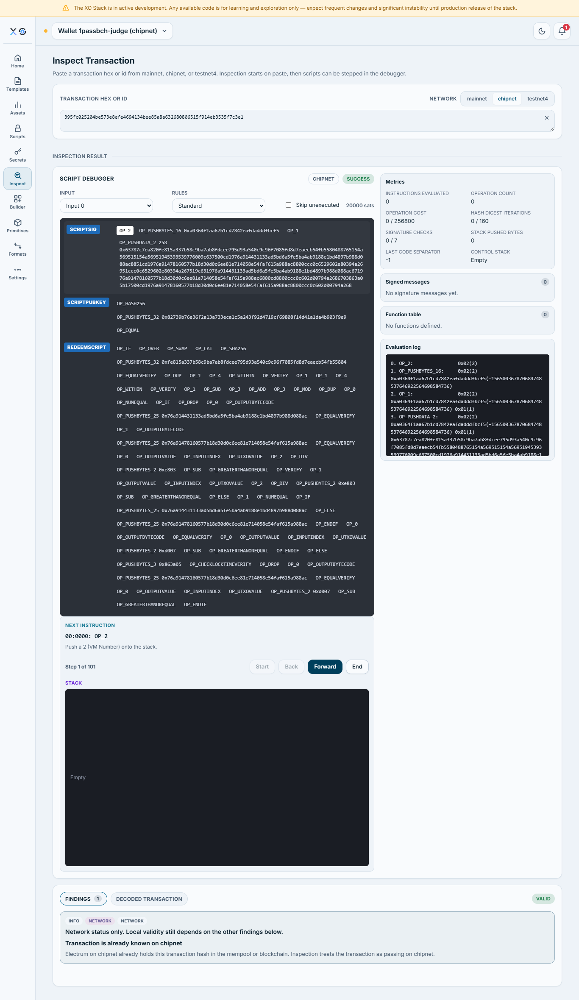
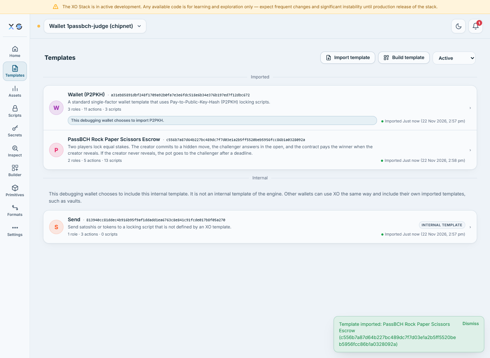

# PassBCH Rock · Paper · Scissors Escrow — an XO template

Submission for the BCH BLAZE 2026 **Build with XO** and **Migrate to XO** bounties (General Protocols).

| | |
|---|---|
| Original working project | **PassBCH.cash** — https://passbch.vercel.app · source https://github.com/Lakshmikanth-3/PassBCH.cash |
| XO implementation (this folder) | https://github.com/Lakshmikanth-3/PassBCH.cash/tree/main/xo |
| Template | [`passbch-duel.template.json`](passbch-duel.template.json) (source with comments: [`passbch-duel.template.mjs`](passbch-duel.template.mjs)) |
| Template identifier | `c556b7a87d64b227bc489dc7f7d03e1a2b5ff5520beb5956fcc86b1a0328092a` |
| Network | Chipnet |
| Engine | `@xo-cash/engine@0.1.1-next.18230317763`, `@xo-cash/templates@0.0.12`, `@xo-cash/utils@0.0.12`, `@xo-cash/types@0.0.9` |

## What was migrated

PassBCH.cash runs Rock · Paper · Scissors with commit-reveal, but the money is **custodial**: the server holds both stakes in a database, decides the winner and pays out, and only *records* the result on chain. This template moves the money itself on chain:

| PassBCH.cash today (custodial) | This XO template (trustless) |
|---|---|
| Stakes sit in the server's database | Both stakes are locked in one on-chain pot, funded from each player's own wallet |
| Server checks `sha256(move:salt)` | The pot's script checks `sha256(move ‖ salt)` against the commitment |
| Server computes the winner | The script computes `(creatorMove − challengerMove + 3) mod 3` |
| Server pays the winner (trusted) | The script only allows the pot to be paid to the winner's script (or 50/50 on a draw) |
| A player who never reveals loses by a server timeout | After `revealDeadline` (CHECKLOCKTIMEVERIFY) the pot can only go to the challenger |

The UX is the XO flow (invitations) instead of PassBCH's web/terminal screens, as the bounty allows.

## How the contract works

Roles: **creator** (moves first, hidden) and **challenger** (answers in the open). Moves are `1` rock, `2` paper, `3` scissors.

1. **`openDuel`** (both roles, one transaction). The creator commits `sha256(move ‖ salt)`, the stake and a deadline block; the challenger chooses a move. Each adds their own coin and their own change; the pot output (`duelOutput`, P2SH32) holds `2 × stake`. Each player also states the locking script they are paid to.
2. **Follow-up `creatorWins` / `challengerWins` / `draw`** (creator). The creator reveals move and salt. The pot script:
   - checks the commitment and that both moves are 1–3,
   - computes the result,
   - requires output 0 to pay the winner's payout script at least `pot − 2000` sats, or, on a draw, outputs 0 and 1 to pay each player at least `pot/2 − 1000`.
3. **Follow-up `claimTimeout`** (challenger). After `revealDeadline`, the pot can only pay the challenger's script.

The pot needs **no signature**: every spend path fixes where the money goes, so nobody (including whoever broadcasts) can redirect it. The full redeem script, stepped in the XO debug tool, is shown below.

## Proof on chipnet

| What | Transaction |
|---|---|
| Duel 1 — `openDuel`: creator (hidden paper) and challenger (rock) each stake 10,000 sats; 20,000-sat pot | [`231206c80404e290355b94156f62f0787eaa4fafa3c731b79412a06b0b882465`](https://chipnet.imaginary.cash/tx/231206c80404e290355b94156f62f0787eaa4fafa3c731b79412a06b0b882465) |
| Duel 1 — follow-up `creatorWins`: reveal `paper` + salt; the script pays the creator 18,000 sats | [`395fc025204be573e8efe4694134bee85a8a632680806515f914eb3535f7c3e1`](https://chipnet.imaginary.cash/tx/395fc025204be573e8efe4694134bee85a8a632680806515f914eb3535f7c3e1) |
| Duel 2 — `openDuel` (the creator never reveals, for the timeout path) | [`65a897ef797763af9a47218bfa0c44c7cad8039fca150c5ae0cbb43666a178b1`](https://chipnet.imaginary.cash/tx/65a897ef797763af9a47218bfa0c44c7cad8039fca150c5ae0cbb43666a178b1) |
| Duel 2 — follow-up `claimTimeout` | see "Timeout path" below |

Invitations used (exactly as produced by the engine, no private keys inside): [`invitations/`](invitations)

| File | What it is |
|---|---|
| `duel1-step1-creator-commits.invitation.json` | The creator's first commit (hidden commitment, stake, deadline, own coin and change) |
| `duel1-step2-challenger-joins.invitation.json` | After the challenger joined (move, coin, change, pot) and signed |
| `duel1-open.invitation.json` | The executed `openDuel` invitation (both signatures, transaction result) |
| `duel1-reveal-creator-wins.invitation.json` | The executed follow-up `creatorWins` invitation (reveals move and salt) |
| `duel2-open.invitation.json` | The executed `openDuel` invitation of duel 2 |

## Check it in the XO debug tool (https://blaze.xo.cash)

1. Create a disposable **chipnet** account.
2. **Templates → Import template**, paste [`passbch-duel.template.json`](passbch-duel.template.json), **Import JSON**. It appears as *PassBCH Rock Paper Scissors Escrow*, identifier `c556b7a8…092a` (the one the invitations reference).
3. **Inspect**, choose **chipnet**, paste the reveal transaction id `395fc025…c3e1`. The result is **SUCCESS**; the debugger steps the redeem script: commitment check, move checks, `OP_SUB OP_3 OP_ADD OP_3 OP_MOD`, and the payout checks with `OP_OUTPUTBYTECODE` / `OP_OUTPUTVALUE`.
4. **Join Invitation** accepts the invitation JSON files from [`invitations/`](invitations).





## Reproduce it

Requires Node.js 20+.

```bash
cd xo
npm install
node wallets.mjs A          # creates two disposable chipnet accounts (mnemonics in .secrets.json, git-ignored)
node wallets.mjs B          # and prints each one's receive address
# fund both addresses with ~30,000 chipnet sats each (https://tbch.googol.cash/ or https://chipnet.bch.ninja/)

node duel.mjs open          # A: commit a hidden move (paper), stake 10,000, add own coin + change -> run/1-open.txt
node duel.mjs join          # B: accept as challenger, play rock, add coin + change + pot, sign      -> run/2-join.txt
node duel.mjs execute       # A: merge B's commits, sign, broadcast openDuel                        -> run/open-tx.txt
node duel.mjs reveal        # A: follow-up action; reveals move + salt, the script pays the winner  -> run/reveal-tx.txt

# timeout path (a second duel where A never reveals)
RUN=run-timeout MOVE=3 node duel.mjs open && RUN=run-timeout node duel.mjs join && RUN=run-timeout node duel.mjs execute
# wait until the chain passes revealDeadline (3 blocks), then:
RUN=run-timeout node duel.mjs timeout
```

Each step is a separate process, as two players on two machines would be; invitations travel as files (`serializeInvitation` / `deserializeInvitation`).

## Timeout path

`claimTimeout` builds a transaction with `locktime = revealDeadline` and sequence 0. The libauth VM (standard rules) accepts it: see `vmcheck.mjs`. At the time of writing, the chipnet nodes still answered `bad-txns-nonfinal` a few blocks after the deadline; a background retry broadcasts the same signed transaction as soon as a node accepts it, and the transaction id will be added here.

## Files

| File | Purpose |
|---|---|
| `passbch-duel.template.mjs` / `.json` | The template (commented source / JSON for import) |
| `duel.mjs` | Runs every action with two engine accounts |
| `wallets.mjs` | Opens the two chipnet accounts (P2PKH wallet template for funding and change) |
| `check.mjs` | Imports the template into an engine and reports validation issues |
| `vmcheck.mjs` | Verifies a built transaction against its parent outputs in the libauth VM |
| `invitations/` | The invitations used for the chipnet transactions above |

## Limits

- Equal stakes are expected; the script uses the pot's real value, so an unequal funding only changes how much each player risks.
- The creator should reveal before the deadline; after it, only the challenger can be paid.
- Up to 2,000 sats of the pot may go to the network fee when paying a winner (1,000 per half on a draw).
- Chipnet only; the XO stack is early-stage (its own warning).

## Feedback on building with XO

See [FEEDBACK.md](FEEDBACK.md) (written by the team member submitting).
